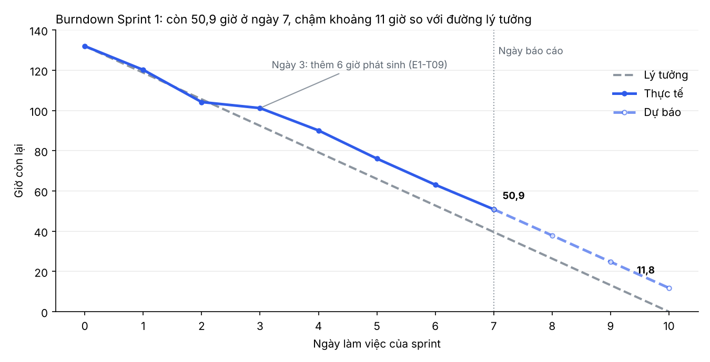

# Báo cáo tiến độ Sprint 1: Kho lạnh Yuki (Product B)

## 1. Iteration và khoảng thời gian

- **Iteration trên Project:** `Sprint 1`.
- **Khoảng thời gian giả lập:** 12/10/2026 đến 23/10/2026 (10 ngày làm việc).
- **Thời điểm báo cáo:** hết ngày làm việc thứ 7 (20/10/2026).
- Đây là sprint giả lập: trạng thái và giờ thực tế không phải của một dự án khách hàng thật. Cột Status của các issue Sprint 1 trên Project được đặt theo bảng bên dưới.

## 2. Trạng thái

| Trạng thái | Số issue | Tổng SWP | Tổng giờ | Ghi chú |
|---|---|---|---|---|
| Done | 13 | 41 | 72 | Bốn issue xong trễ 1 ngày: #3 E1-T02 (tích hợp vai trò ROLE-001..008 phức tạp hơn dự kiến), #27 E3-T01 (thêm ca chuyển trạng thái cách ly), #35 E4-T02, #89 E8-T06 (chờ dữ liệu mẫu) |
| In Progress | 5 | 23 | 36 | #8 E1-T07 và #34 E4-T01 trễ do chờ danh sách hợp đồng khách × SKU; #36 E4-T03 đến hạn hôm nay; #16 E2-T01 và #22 E2-T04 đúng kế hoạch |
| Blocked | 1 | 2 | 3 | #55 E5-T12 chờ khách xác nhận các mức giờ lái; trên Project nằm ở cột In Progress kèm nhãn `blocked` |
| To do | 4 | 17 | 27 | #28 E3-T02, #29 E3-T03, #37 E4-T04, #84 E8-T01; chưa bắt đầu, #84 có thể chuyển sang Sprint 2 |
| **Tổng** | **23** | **83** | **138** | Gồm 1 issue phát sinh (#13 E1-T09, 3 SWP, 6 giờ) thêm vào ngày 3 |

Số issue ở đây là số task; các sub-issue (#9 đến #11 của #8, #38 đến #40 của #37) được tính trong SWP và giờ của task cha.

## 3. Burndown

Burndown tính theo giờ ước lượng còn lại. Đường lý tưởng bắt đầu từ 132 giờ cam kết ban đầu.

| Ngày | Ngày lịch | Lý tưởng (giờ) | Thực tế (giờ) | Dự báo (giờ) |
|---|---|---|---|---|
| 0 | 09/10 | 132,0 | 132,0 | |
| 1 | 12/10 | 118,8 | 120,2 | |
| 2 | 13/10 | 105,6 | 104,2 | |
| 3 | 14/10 | 92,4 | 101,2 | |
| 4 | 15/10 | 79,2 | 90,1 | |
| 5 | 16/10 | 66,0 | 76,1 | |
| 6 | 19/10 | 52,8 | 63,1 | |
| 7 | 20/10 | 39,6 | 50,9 | 50,9 |
| 8 | 21/10 | 26,4 | | 37,9 |
| 9 | 22/10 | 13,2 | | 24,8 |
| 10 | 23/10 | 0,0 | | 11,8 |

**Thực tế lệch kế hoạch ở đâu.** Hai ngày đầu đi đúng đường lý tưởng. Từ ngày 3 đường thực tế nằm trên đường lý tưởng, và đến ngày 7 còn 50,9 giờ so với 39,6 giờ, tức chậm khoảng 11 giờ. Có ba nguyên nhân. Một là phạm vi tăng 6 giờ ở ngày 3 do việc phát sinh #13 (xử lý dữ liệu hợp đồng thiếu), và việc này tốn khoảng 9 giờ thực tế. Hai là #8 và #34 bị chậm vì chờ danh sách hợp đồng, kéo theo nhóm BE phải làm việc khác. Ba là nhóm BE chịu tải 89% capacity của sprint nên không còn chỗ bù. Với tốc độ đốt 13 giờ mỗi ngày của ba ngày gần nhất, cuối sprint còn khoảng 11,8 giờ chưa xong (khoảng 9% phạm vi), chủ yếu là #37 và #84.

## 4. Rủi ro trễ

| Rủi ro | Issue | Ảnh hưởng tới mốc nào | Hành động | Ai làm, khi nào |
|---|---|---|---|---|
| R-01: các mức giờ lái xe 2024 chưa được khách xác nhận | #55 E5-T12, #57 E5-T02, #59 đến #62 | Sprint 3 (từ 09/11): không bắt đầu được các issue kiểm giờ lái; ước lượng epic E5 (80 giờ) có thể đổi | Cấu hình hóa tham số (#57) để đổi không phải sửa mã; chốt biên bản với khách; dự phòng 15% giờ cho E5 | QA-1, trước 30/10 |
| R-02: chưa chốt cách so 日付逆転 (lô giao gần nhất hay hạn lớn nhất) | #37 E4-T04, #41 E4-T05, #51 E4-T09 | Kết thúc Sprint 1 (23/10): #37 chưa bắt đầu; Sprint 2: khóa chống race | Hỏi khách và đối chiếu RFP trước khi bắt đầu #37; viết test cho cả hai cách (G-02 trong PREMISE.md) | QA-1, trước 21/10 |
| R-03: thiếu dữ liệu hợp đồng khách × SKU, nhiều đơn rơi vào BUSINESS_REVIEW | #8 E1-T07, #34 E4-T01, #45 E4-T06 | Kết thúc Sprint 1: #8 và #34 trễ; Sprint 2: #45 | Gửi khách danh sách cặp chưa cấu hình (xuất từ #13, đã xong); dùng dữ liệu mẫu để không chặn phát triển | BE-2, trước 23/10 |
| R-04: nhóm BE quá tải, còn khoảng 36 giờ BE cho 3 ngày cuối (capacity khoảng 30 giờ) | #16, #28, #36, #37, #84 | Kết thúc Sprint 1 | Chuyển #84 sang Sprint 2 nếu ngày 9 chưa bắt đầu; FE hỗ trợ viết test | PM và QA-1, trước 21/10 |
| R-05: race condition khó tái hiện và kiểm thử | #41 E4-T05 (#42 đến #44), #53 E4-T11 | Sprint 2 (kết thúc 06/11) | Dựng môi trường chạy hai phiên song song từ đầu Sprint 2; chọn khóa advisory theo cặp khách × SKU (H-01) | BE-1, trước 06/11 |
| R-07: prototype không có nhật ký nhiệt độ, nên HACCP phải làm mới và có thể lớn hơn ước lượng | #71 đến #74, #77 | Sprint 2 và Sprint 3 | Spike nhỏ đầu Sprint 2 để kiểm lại ước lượng; giữ #76 ở mức Could | BE-1, trước 30/10 |
| R-06: dịch vụ miễn phí tự tạm dừng project, gián đoạn demo hoặc UAT | #86 E8-T03 | Sprint 4 | Quy trình đánh thức; gói không tạm dừng cho môi trường thật | BE-1, trước 04/12 |
| R-08: đơn vị số lượng lệch giữa tài liệu và dữ liệu thật | #16 E2-T01, #52 E4-T10 | Sprint 2 | Spec đã sửa theo P-02; kiểm lại với dữ liệu UAT | QA-1, trước 06/11 |
